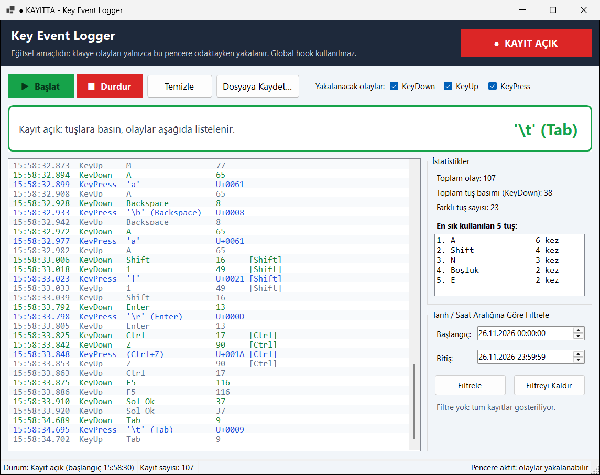
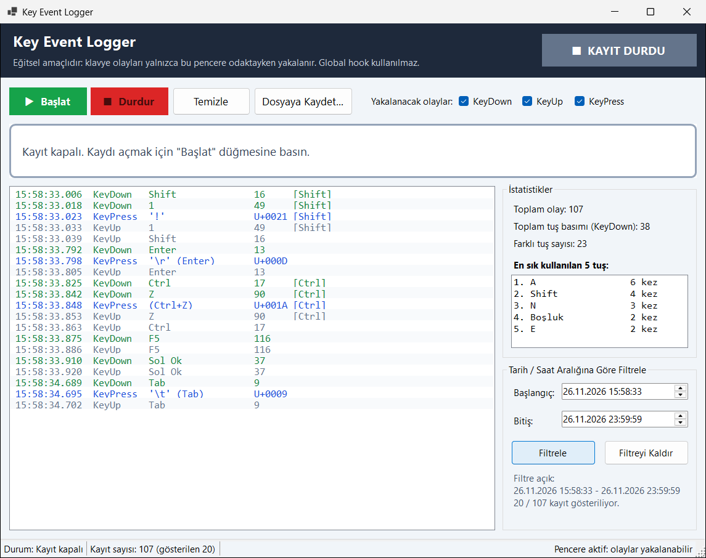
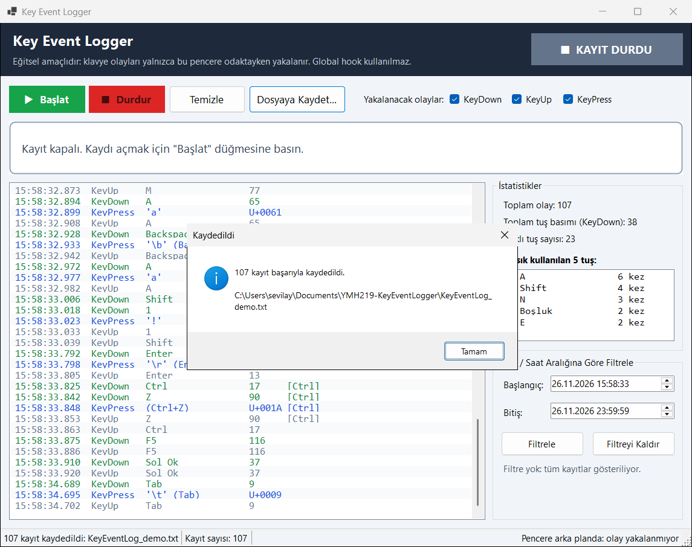

# Key Event Logger (Eğitsel Keylogger)

**Nesne Tabanlı Programlama (YMH 219): Ek Uygulama Ödevi 2**

C# ve Windows Forms ile yazılmış, klavye olaylarının (`KeyDown`, `KeyUp`, `KeyPress`) nasıl yakalandığını ve işlendiğini gösteren eğitsel bir masaüstü uygulaması. Uygulama **yalnızca kendi penceresi odaktayken** basılan tuşları, tuş adı ve zaman bilgisiyle listeler. İstenirse kayıtlar yerel bir `.txt` dosyasına kaydedilir.

| Öğrenci | Bilgi |
|---|---|
| Adı Soyadı | Berkay Tatar |
| Öğrenci No | 250541024 |

## Ekran Görüntüleri

**Kayıt açıkken:** kırmızı "KAYIT AÇIK" göstergesi, renkli olay listesi, son basılan tuş ve canlı istatistikler



**Kayıt durdurulmuş, tarih/saat aralığı filtresi uygulanmış** (107 kayıttan 20'si gösteriliyor)



**Kayıtların .txt dosyasına kaydedilmesi**



Kaydedilen dosyanın bir örneği: [`docs/ornek-kayit.txt`](docs/ornek-kayit.txt)

## Kullanılan Teknolojiler

| Teknoloji | Açıklama |
|---|---|
| C# | Programlama dili |
| .NET 10 (`net10.0-windows`) | Çalışma ortamı |
| Windows Forms | Masaüstü arayüz |
| `System.IO` (`StreamWriter`) | Kayıtları dosyaya yazma |
| Visual Studio 2026 | Geliştirme ortamı |

**NuGet paketi kullanılmadı.** Yalnızca .NET'in kendi kütüphaneleri kullanıldı.

## Kurulum ve Çalıştırma

Gereken: Visual Studio 2026 ve ".NET masaüstü geliştirme" iş yükü (.NET 10 SDK).

**Visual Studio ile:**

1. Depoyu klonlayın: `git clone https://github.com/<kullanici-adi>/YMH219-KeyEventLogger.git`
2. `KeyEventLogger.sln` dosyasını Visual Studio ile açın.
3. **F5** tuşuna basın ya da üstteki yeşil ▶ **KeyEventLogger** düğmesine tıklayın.

**Komut satırı ile:**

```powershell
dotnet run --project KeyEventLogger
```

## Kullanım

1. **▶ Başlat** düğmesine basın. Sağ üstteki gösterge kırmızı **● KAYIT AÇIK** olur, pencere başlığında da `● KAYITTA` yazar.
2. Uygulama penceresi aktifken tuşlara basın. Her olay zaman, olay türü, tuş adı, tuş kodu ve değiştirici tuşlarla (Ctrl/Shift/Alt) listelenir.
3. **■ Durdur** düğmesi kaydı durdurur. Gösterge gri **■ KAYIT DURDU** olur.
4. **Temizle** düğmesi, onay aldıktan sonra ekrandaki kayıtları siler.
5. **Dosyaya Kaydet…** düğmesi kayıtları seçtiğiniz `.txt` dosyasına yazar.
6. "Yakalanacak olaylar" kutucuklarıyla `KeyDown` / `KeyUp` / `KeyPress` olaylarını ayrı ayrı açıp kapatabilirsiniz.

## Temel Özellikler

### Föydeki asgari gereksinimler

| Gereksinim | Uygulamadaki karşılığı |
|---|---|
| Pencere aktifken basılan tuş adı ve zaman bilgisi ListBox üzerinde gösterilmeli | `lstLog` (ListBox): `HH:mm:ss.fff` zaman, olay türü, tuş adı, kod, değiştiriciler |
| Başlat ve Durdur butonları ile kayıt durumu kontrol edilmeli | `btnStart`, `btnStop` → `KeyEventRecorder.Start()` / `Stop()` |
| Temizle butonu ile ekrandaki kayıtlar silinebilmeli | `btnClear` (onay sorar) → `KeyEventRecorder.Clear()` |
| Kayıtlar istenirse .txt dosyasına kaydedilebilmeli | `btnSave` + `SaveFileDialog` → `TextFileLogWriter` (`StreamWriter`, UTF-8) |
| Kayıt durumunu belirten açık bir gösterge | Kırmızı/gri durum etiketi, pencere başlığı, yakalama alanının kenar rengi, durum çubuğu |

### İsteğe bağlı geliştirmeler (föyde önerilen)

- **İstatistik:** toplam olay sayısı, toplam tuş basımı, farklı tuş sayısı ve **en sık kullanılan 5 tuş**
- **Tarih/saat aralığına göre filtreleme:** başlangıç ve bitiş zamanı seçilir, yalnızca aralıktaki kayıtlar gösterilir. Filtre açıkken "Dosyaya Kaydet" görünen kayıtları kaydeder.

### Ek özellikler

- Olay türüne göre renklendirilmiş liste: KeyDown yeşil, KeyPress mavi, KeyUp gri
- `KeyDown` ile `KeyPress` farkı açıkça görülür: `Shift+1` için KeyDown `1` (kod 49), KeyPress `'!'` olur
- Türkçe ve anlaşılır tuş adları: `Boşluk`, `Sol Ok`, `Enter`, `(Ctrl+S)` vb.
- Tab, ok tuşları, Enter gibi normalde form tarafından "yutulan" tuşlar da yakalanır (özel `KeyCaptureBox` kontrolü)
- Pencere arka plana geçtiğinde kullanıcı uyarılır: "Pencere arka planda: olay yakalanmıyor"
- Kaydedilmemiş kayıtlar varken uygulama kapatılırsa kaydetme seçeneği sunulur
- Dosya hataları (izin yok, klasör yok, dosya kilitli vb.) uygulamayı kapatmadan anlaşılır mesajla bildirilir

## Kapsam ve Güvenlik Sınırı

Bu uygulama **gerçek bir sistem keylogger'ı değildir** ve föydeki güvenlik sınırına uyar:

- Olaylar yalnızca formun kendi `KeyDown` / `KeyUp` / `KeyPress` olaylarından (`KeyPreview = true`) alınır. Pencere odakta değilken Windows bu olayları uygulamaya hiç göndermez.
- **Global keyboard hook yoktur** (`SetWindowsHookEx` vb. kullanılmaz).
- Gizli / arka plan çalışması, sistem tepsisine gizlenme veya **başlangıçta otomatik çalışma yoktur.**
- Başka uygulamalardan veri toplanmaz. Parola alanı yoktur, kimlik bilgisi yakalanmaz.
- Kayıtlar **ağ üzerinden gönderilmez.** Yalnızca kullanıcının seçtiği yerel dosyaya, kullanıcı istediğinde yazılır.
- Kaydın açık olduğu her an ekranda açıkça gösterilir.

## Proje Yapısı

```
YMH219-KeyEventLogger/
├── KeyEventLogger.sln
├── KeyEventLogger/
│   ├── Program.cs                     Giriş noktası
│   ├── MainForm.cs                    Pencere: olayları yakalar, arayüzü günceller
│   ├── MainForm.Designer.cs           Form tasarımcısı kodu
│   ├── Models/
│   │   ├── KeyEventType.cs            Enum: KeyDown, KeyUp, KeyPress
│   │   └── KeyEventRecord.cs          Tek bir olay kaydı (değiştirilemez sınıf)
│   ├── Core/
│   │   ├── KeyEventRecorder.cs        Kayıt durumu ve kayıt listesi + event'ler
│   │   ├── KeyEventRecordedEventArgs.cs
│   │   └── KeyNameFormatter.cs        Tuş/karakter adlarını okunur hale getirir
│   ├── Services/
│   │   ├── ILogWriter.cs              Dosyaya yazma arayüzü
│   │   ├── TextFileLogWriter.cs       StreamWriter ile .txt yazımı
│   │   ├── LogFileException.cs        Özel istisna sınıfı
│   │   ├── KeyStatistics.cs           İstatistik hesaplama
│   │   └── TimeRangeFilter.cs         Tarih/saat aralığı filtresi
│   └── Controls/
│       └── KeyCaptureBox.cs           Control'den türetilmiş tuş yakalama alanı
└── docs/
    ├── screenshots/                   README ekran görüntüleri
    └── ornek-kayit.txt                Örnek kayıt dosyası
```

## Kullanılan OOP Kavramları

| Kavram | Koddaki örneği |
|---|---|
| **Kapsülleme** | `KeyEventRecorder` kayıt listesini `private` tutar, dışarıya yalnızca `ReadOnlyCollection` verir. `IsRecording` yalnızca `Start()` / `Stop()` ile değişir (`private set`). |
| **Değiştirilemez nesne** | `KeyEventRecord` sınıfının tüm özellikleri salt okunurdur, değerler yapıcıda atanır. |
| **Factory method** | `KeyEventRecord.FromKeyEvent(...)` ve `KeyEventRecord.FromKeyPress(...)`. Yapıcı `private`. |
| **Kalıtım ve override** | `KeyCaptureBox : Control`. `IsInputKey`, `OnPaint`, `OnKeyPress`, `OnGotFocus` metotları ezilir. `KeyEventRecord.ToString()` override edilir. |
| **Arayüz (interface)** | `ILogWriter`: form somut sınıfa değil arayüze bağımlıdır. CSV gibi yeni bir biçim için yalnızca yeni bir sınıf yazmak yeterlidir. |
| **Olay (event)** | `KeyEventRecorder.RecordAdded`, `RecordingStateChanged`, `RecordsCleared` olaylarına form abone olur. Özel `KeyEventRecordedEventArgs` sınıfı kullanılır. |
| **Özel istisna** | `LogFileException : Exception`. Asıl hata `InnerException` içinde taşınır. |
| **Hata yönetimi** | `try/catch` ile `UnauthorizedAccessException`, `DirectoryNotFoundException`, `IOException` vb. yakalanır. `using` ile dosya her durumda kapatılır. Geçersiz filtre aralığı `ArgumentException` ile reddedilir. |
| **Enum** | `KeyEventType { KeyDown, KeyUp, KeyPress }` |
| **Statik yardımcı sınıf** | `KeyNameFormatter` (durum tutmaz) |
| **Sorumlulukların ayrılması** | Kayıt mantığı `Core`, dosya ve istatistik işlemleri `Services`, görünüm `MainForm` içinde. |

## Kayıt Dosyası Biçimi

```
# Key Event Logger - Klavye Olay Kayıtları
# Oluşturulma : 26.11.2026 15:59:07
# Kayıt sayısı: 107
# Not: Kayıtlar yalnızca uygulama penceresi odaktayken alınmıştır.
------------------------------------------------------------------------------------------
[26.11.2026 15:58:30.504] KeyDown  | Tuş: Shift            | Kod: 16     | Değiştirici: Shift
[26.11.2026 15:58:30.516] KeyDown  | Tuş: N                | Kod: 78     | Değiştirici: Shift
[26.11.2026 15:58:30.529] KeyPress | Tuş: 'N'              | Kod: U+004E | Değiştirici: Shift
[26.11.2026 15:58:30.531] KeyUp    | Tuş: N                | Kod: 78     | Değiştirici: Shift
```

## Bilinen Sınırlamalar / Geliştirme Notları

- Uygulama yalnızca Windows'ta çalışır (Windows Forms).
- **Print Screen** tuşu Windows tarafından işlendiği için yalnızca `KeyUp` olayı üretir.
- **Alt+F4**, **Alt+Tab** ve **Windows tuşu** kombinasyonları işletim sistemi tarafından işlenir. Kayda düşebilirler ama pencereyi kapatma ya da odaktan çıkarma gibi etkileri de olur.
- Ekran klavyesi veya yazılımla gönderilen Unicode karakterler `KeyDown` olayında `Unicode (Packet)` olarak görünür. Karakterin kendisi `KeyPress` satırında yer alır.
- Filtre tarih/saat aralığına göre çalışır. Kayıt açıkken gelen yeni olaylar da filtreye uyuyorsa listeye eklenir.
- İstatistikler, filtreden bağımsız olarak tüm kayıtlar üzerinden hesaplanır.
- Olası geliştirmeler: CSV biçiminde dışa aktarma (yeni bir `ILogWriter` sınıfıyla), olay türüne göre filtreleme, birim testleri.
